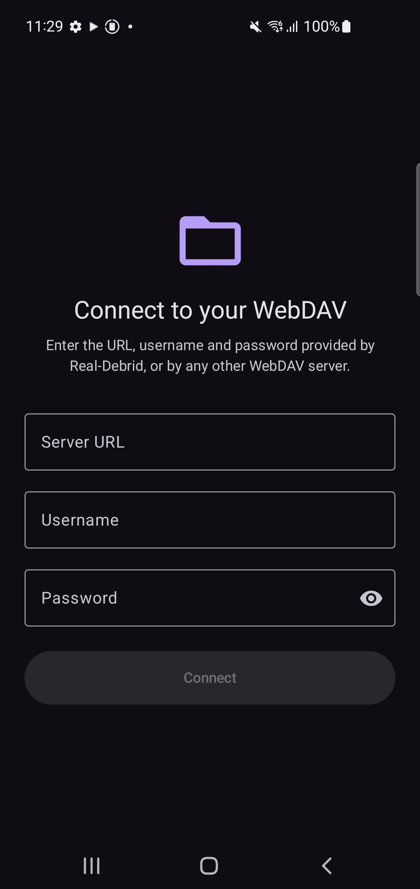
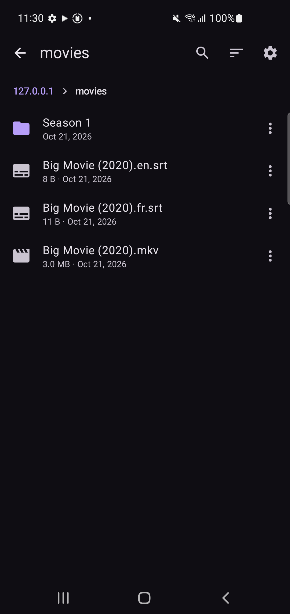
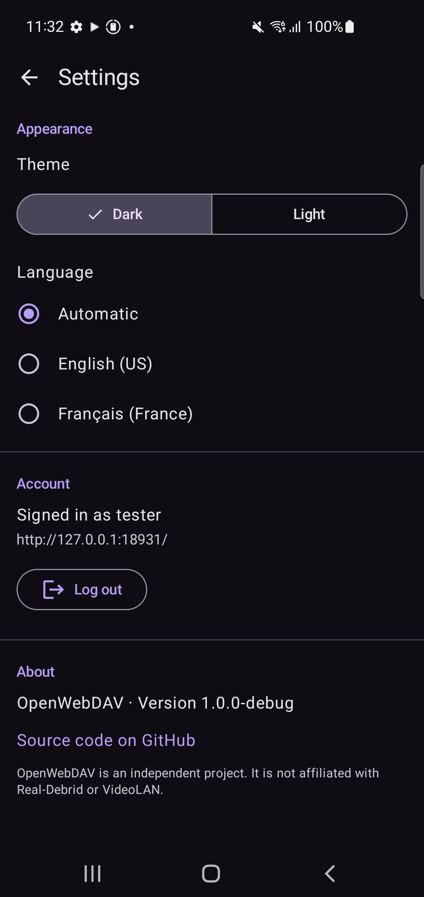

# OpenWebDAV

A fast, simple Android app to browse your WebDAV storage and play your videos in VLC.
It is designed for the WebDAV access provided by Real-Debrid (URL, username and password),
and works with any WebDAV server served over HTTPS.

<p align="center">
  
  
  
</p>

## Features

- **Fast, fluid browsing.** Folders you already visited open instantly from memory and refresh in the
  background. Pull down to refresh, use the breadcrumb bar to jump back to any parent folder, and the
  system back button goes up one folder.
- **Plays videos in VLC.** Tap a video (mp4, mkv, avi, mov, webm, ts and more) and it opens straight in
  [VLC for Android](https://www.videolan.org/vlc/download-android.html), streamed from your server.
  If VLC is not installed, the app offers to install it from Google Play or F-Droid.
- **Subtitles.** If a subtitle file sharing the video's name sits in the same folder
  (for example `Movie.mkv` and `Movie.en.srt`), it is loaded in VLC automatically.
  It is saved to `Download/OpenWebDAV/Subtitles` first, because VLC only accepts local subtitle files.
- **Search and sort** the current folder. Sort by name (natural order, so `E2` comes before `E10`), date or
  size, ascending or descending. Folders always come first.
- **Download, copy and share.** Long-press a file or use the ⋮ menu to download it, open it with another app,
  copy its link, or share its link. Other file types (images, audio, documents) open in your default app.
- **Stays signed in.** Your URL, username and password are stored encrypted with the Android Keystore and the
  app reconnects automatically at every launch. Log out from Settings; this also erases the saved credentials.
- **Dark by default.** Switch to the light theme in Settings.
- **English (US) and French (France).** French is used when the device language is French, English (US) for
  every other device language. You can also pick a language manually in Settings.

## Install

Download `OpenWebDAV-1.0.1.apk` from the [latest release](https://github.com/LinuxKernel44/OpenWebDAV/releases/latest)
and open it on your device. Android 8.0 (API 26) or newer is required.

## Usage

1. Open the app and enter the WebDAV URL, username and password given by your provider.
   The URL must start with `https://`.
2. Browse your folders and tap a video to watch it.

## Privacy and security

- Credentials never leave your device except as HTTP Basic authentication to the server you entered.
- The password is not included in links you copy or share.
- To let VLC stream a video, the app hands VLC a link that contains your username and password. Only VLC
  (or the app you pick with **Open with…**) receives it.
- Plain `http://` servers are refused in release builds.

## Build from source

Requirements: JDK 17 and the Android SDK (platform 35).

```sh
./gradlew testDebugUnitTest   # unit tests
./gradlew assembleDebug       # debug APK in app/build/outputs/apk/debug
./gradlew assembleRelease     # needs a keystore.properties file, see below
```

To sign a release build, create an untracked `keystore.properties` at the repository root:

```properties
storeFile=/path/to/your.jks
storePassword=...
keyAlias=...
keyPassword=...
```

Debug builds accept plain `http://` servers so you can test against a local server.

## Tech stack

Kotlin, Jetpack Compose (Material 3), OkHttp (`PROPFIND`), WorkManager (downloads),
AndroidX Security (encrypted credential storage).

## Disclaimer

OpenWebDAV is an independent project. It is not affiliated with Real-Debrid or VideoLAN.
Use it only with content you have the right to access.

## License

[MIT](LICENSE)
